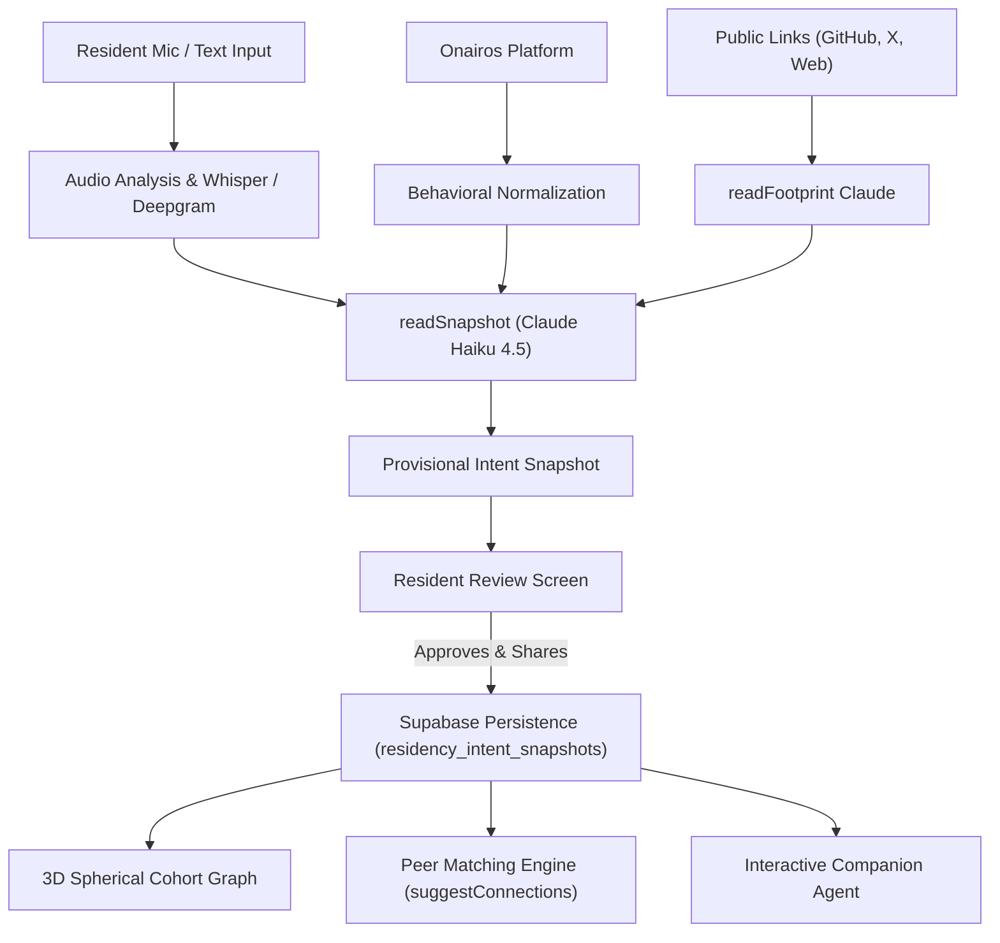

# Onboarding & Cohort Intelligence Architecture

The Field Station Residency onboarding and peer-intelligence system is designed around genuine human agency, ambient intelligence, and grounded collaboration.

---

## 1. Multi-Modal Intake
* **Three Questions**:
  1. *What are you working toward right now, and why does it matter to you?* $\to$ Maps to `intent`.
  2. *What problem, question, or opportunity are you focused on?* $\to$ Maps to `problem`.
  3. *How are you approaching it so far and what are you still trying to figure out?* $\to$ Deconstructed into `approach` (first half) and `current_frontier` (second half).
* **Onairos Connection**:
  * Authorized OAuth / Widget connection reads behavioral patterns from the resident's apps.
  * Normalizes into an archetype, positive strengths, co-occurrence rationale, and coverage meter.
* **Public Footprint**:
  * Inspects public technical work (e.g. GitHub repos, writing, portfolio) with strict PII filtering.

---

## 2. Dynamic 3D Spherical Cohort Graph
* Projective geometry positions residents and thematic approach nodes onto a 3D spherical shell.
* Nodes grow and cluster organically based on shared problem definitions, complementary approaches, and mutual contribution overlaps.
* **Camera projection**:
  * Calculates depth bands, scaling, and z-index occlusion.
  * Interactive drag, pinch-to-zoom, and focal node pinning.

---

## 3. Cognitive Companion Agent
* Grounded in longitudinal resident memory:
  * Reads current intent, frontier, archetype, strengths, and recent journal moments.
* Recommends cohort peers by name when complementary skills or overlapping problems arise.
* Captures architectural insights into permanent memory via auto-generated `note` entries.

